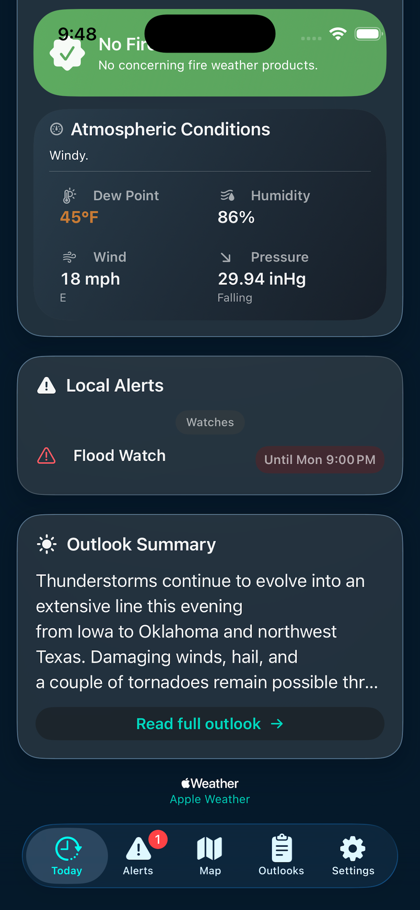
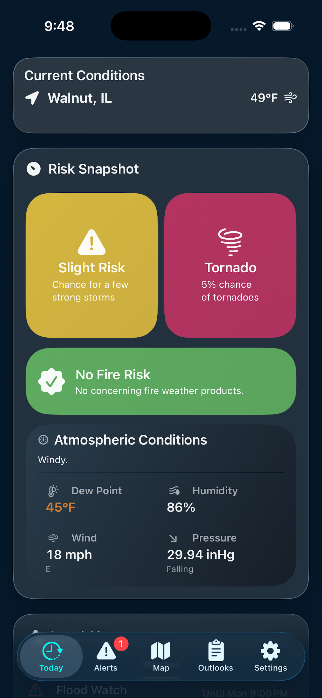
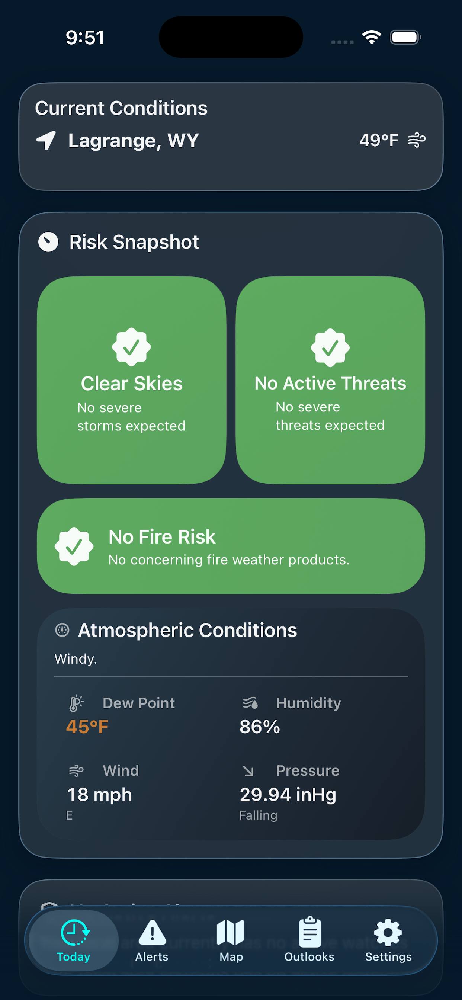
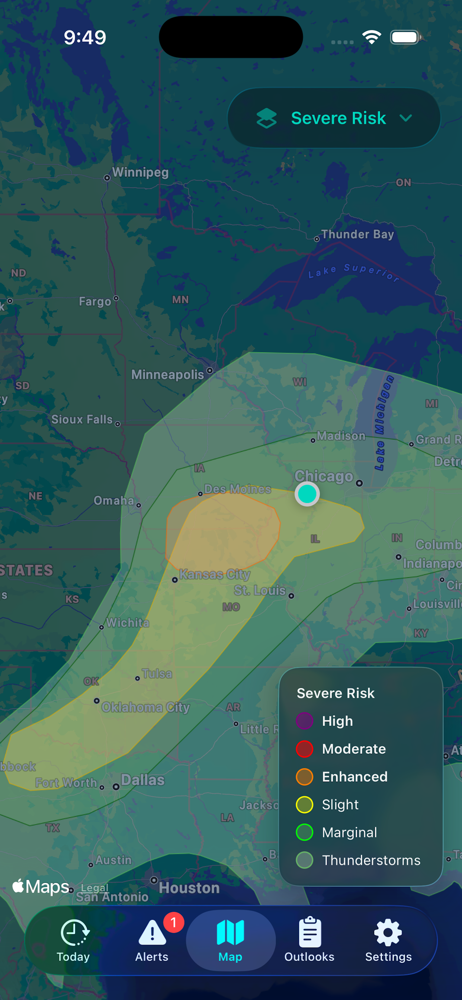
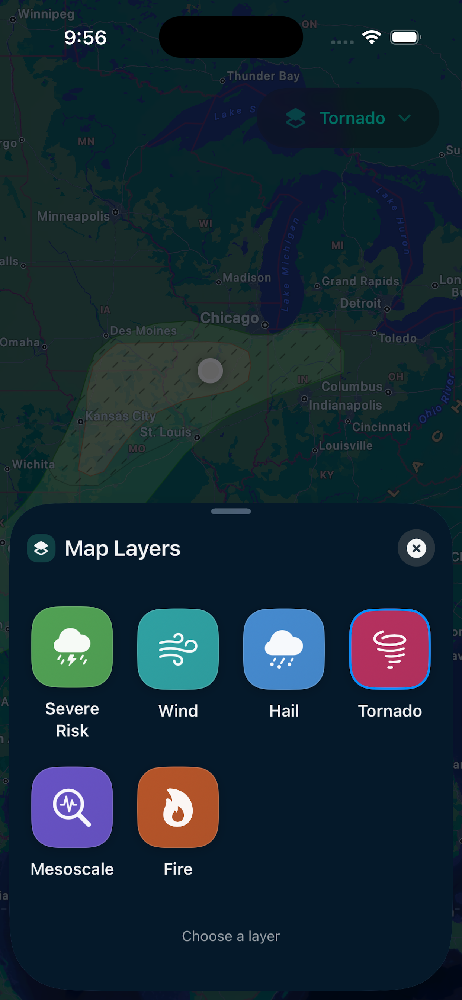
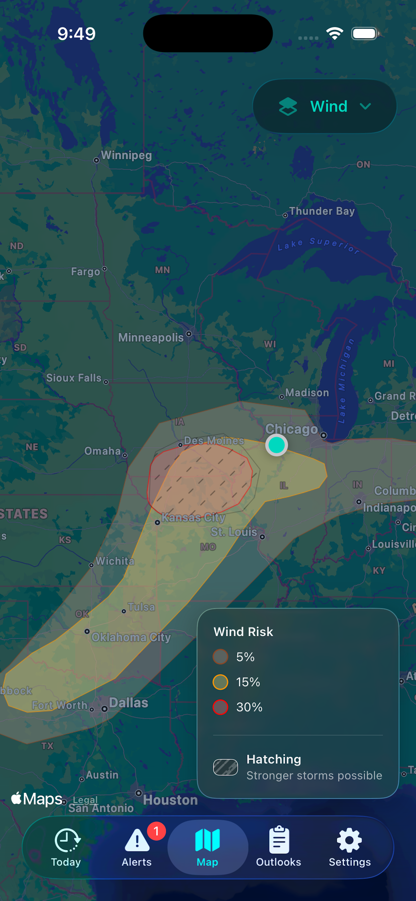
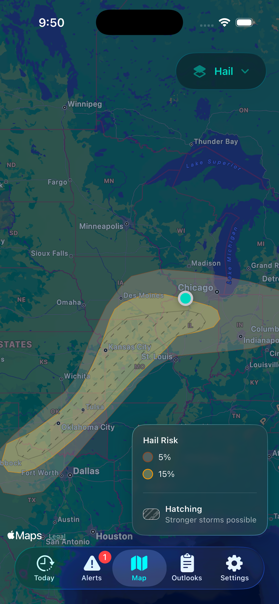
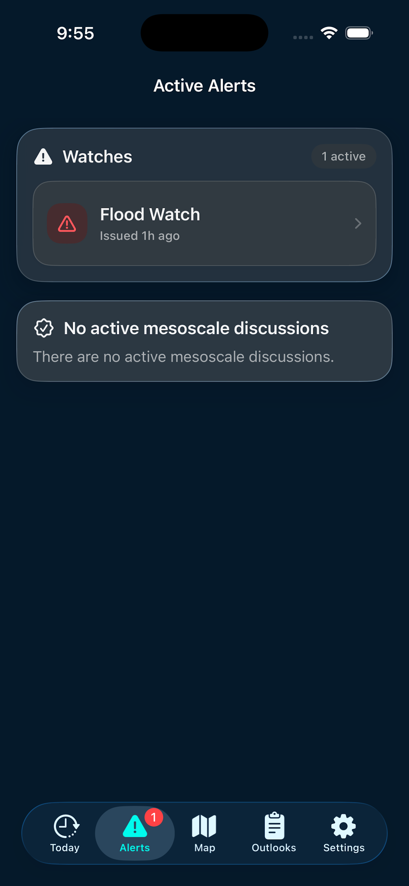
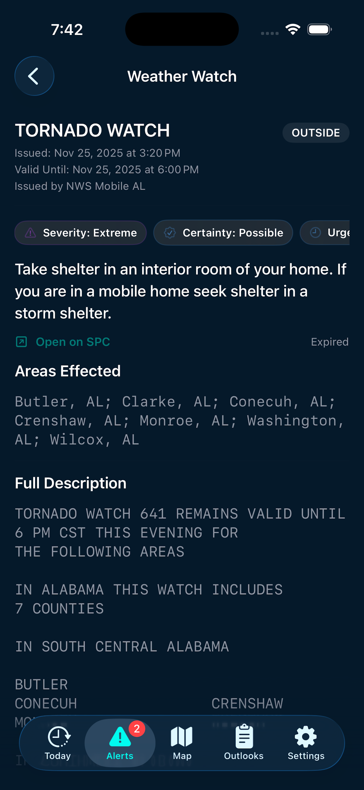

# SkyAware

SkyAware is an iOS app for hyper-local severe-weather awareness. It helps people understand local weather risks, active alerts, and evolving conditions in a clear, glanceable experience. This repository contains the app, its widgets, tests, and development documentation.

## Public Site

[skyaware.app](https://www.skyaware.app)

## Join the Beta

Try SkyAware on TestFlight and help shape the app.

[Join the SkyAware beta on TestFlight](https://testflight.apple.com/join/2hnEnj6e)

## Key Features

- Local severe-weather risk, alerts, and outlooks
- Location-aware morning summaries, risk-change notifications, and relevant watches, warnings, and mesoscale discussions
- Interactive severe-weather risk maps and glanceable widgets
- Current conditions, Storm Setup, and winter-weather awareness where supported and enabled
- Cache-forward presentation, opportunistic background refresh, and in-app diagnostics

The app combines SPC and NWS products, Apple WeatherKit, and Arcus backend services. The repository includes Forge WSSI integration alongside existing Signal integrations; this does not establish production deployment or backend migration status.

## Screenshots
| Today + Alerts | Today + Risks | Today (Clear) |
|---|---|---|
|  |  |  |

| Map (Categorical Risk) | Map Layers | Wind Risk |
|---|---|---|
|  |  |  |

| Hail Risk | Active Alerts | Watch Detail |
|---|---|---|
|  |  |  |

## Getting Started

### Requirements

- Swift 6 and a compatible Xcode version with the required SDK and simulator runtime
- iOS 18+ for the app; check the Xcode project for individual target requirements

### Open in Xcode

```sh
xed SkyAware.xcodeproj
```

## Build & Run

```sh
xcodebuild -project SkyAware.xcodeproj -scheme SkyAware -destination "platform=iOS Simulator,name=iPhone 17" build
```

App configuration lives in `Config/`, and shared assets and previews live in `Resources/`. Use local developer provisioning and secure configuration for capabilities that require credentials. Enable the permissions appropriate to the behavior being tested.

## Development and Documentation

- [Knowledge index](docs/README.md): product, design, architecture, validation, and operational documentation.
- [Repository guidance](AGENTS.md): development constraints, required validation lanes, and working instructions.
- [Source guidance](Sources/AGENTS.md): app-layer architecture and persistence safeguards.
- [CI and test-lane procedures](tools/ci/README.md): regression, performance, and UI navigation validation.
- [PR template](.github/pull_request_template.md): contribution and review evidence.

Keep private keys and WeatherKit credentials out of the repository. Do not log sensitive location or alert data in production code.

## Weather Awareness Disclaimer

SkyAware provides informational severe-weather awareness only and does not issue official warnings. Risk summaries, badges, and notifications are provided on a best-effort basis and should not be relied upon as a sole source of emergency information. Always rely on official alerts from the National Weather Service, NOAA Weather Radio, and local authorities. See [EULA](legal/EULA.md) for full terms.

## License

Use of SkyAware is governed by the [End-User License Agreement](legal/EULA.md).
