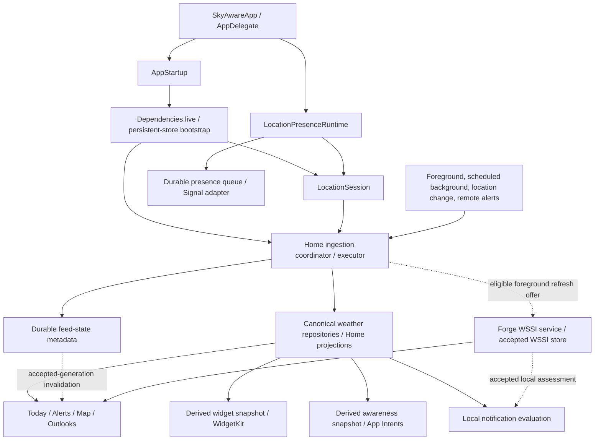

# SkyAware Client Architecture

## Purpose and scope

SkyAware is a local severe-weather awareness client. It acquires weather products, resolves their relevance to an accepted location, retains useful local state, and presents that state through Today, Alerts, Map, Outlooks, Settings, widgets, notifications, and App Shortcuts.

This document describes client composition and ownership, not backend internals, meteorological methodology, or deployment status. [North Star](../product/north-star.md) owns product meaning; [Design](../design/README.md) and [Brand and Voice](../brand/brand-and-voice.md) own presentation and communication. [Arcus ecosystem](https://github.com/justinrooks/Prompt_Fu/blob/main/docs/arcus/README.md) owns cross-system responsibilities and migration direction.

The app targets iOS 18+ with Swift 6 concurrency. See the [Xcode project](../../SkyAware.xcodeproj/project.pbxproj) for individual target settings and [resolved packages](../../SkyAware.xcodeproj/project.xcworkspace/xcshareddata/swiftpm/Package.resolved) for consumed dependency versions. SwiftUI, Observation, SwiftData, Core Location, BackgroundTasks, UserNotifications, MapKit, WeatherKit, WidgetKit, AppIntents, OSLog, and Security provide the platform boundaries.

## Architectural intent

- **Explicit composition:** manual dependency wiring makes runtime ownership and failure policies visible. A large composition root is not, by itself, a design defect. Test and preview dependencies must be intentional, not silent production fallbacks.
- **Isolated ownership:** actors, ModelActors, and main-actor presentation owners protect different forms of mutable state. Keep isolation, task lifetime, and persistence ownership explicit.
- **Unified ingestion:** lifecycle callers submit work to common coordination and execution boundaries rather than maintaining competing Home refresh implementations.
- **Cache-forward awareness:** render useful accepted local state promptly, resolve forward, and preserve useful same-location data during failures. Optional enrichment must not unnecessarily delay useful core publication.
- **Location-scoped truth:** accepted observations, resolved weather context, and durable presence have different readiness requirements. Location, execution, source revision, and presentation identity are distinct.
- **Derived consumers:** widgets and App Shortcuts represent accepted state; neither becomes an independent weather authority.
- **Honest degradation:** stale, unavailable, failed, skipped, and authoritatively empty results carry different meaning. Do not manufacture a quiet assessment from missing evidence.

The earlier [architecture recovery](../audits/codebase-architecture-recovery.md) and [simplification roadmap](../plans/codebase-simplification-roadmap.md) found these boundaries essential rather than accidental complexity. Manual composition, unified ingestion, and atomic persistence were deliberately retained instead of introducing a DI framework, generic repository framework, global event bus, app-wide ingestion rewrite, speculative projection redesign, or organizational module extraction. Reconsider such choices only with a concrete problem and evidence that the existing boundary is inadequate; these are contextual design decisions, not permanent bans.

## System composition

This is an ownership and data-flow orientation, not an exhaustive execution or dependency graph. For example, Map and Outlooks consume their canonical repository data, not just Home projections. Feed metadata is not domain data. Feature-local operations can have their own execution paths without becoming competing Home ingestion owners.

[AppStartup](../../Sources/App/AppStartup.swift) constructs and installs a complete weather dependency graph once ready. Storage failures remain retryable; protected-data unavailability is distinct from other storage failures. [Persistent-store bootstrap](../../Sources/App/SkyAwarePersistentStoreBootstrap.swift) opens/migrates the cache and permits quarantine recovery only with appropriate evidence. Unknown or access-related failures are not permission to erase a store. Explicit deterministic UI-test composition may use transient persistence; it does not establish normal background persistence availability.

[LocationPresenceRuntime](../../Sources/Infrastructure/Location/LocationPresenceRuntime.swift) is process-owned and established independently of weather-store readiness. The live graph reuses its location authority. Durable eligible H3 presence admission need not wait for NWS enrichment or for the full weather graph to exist. The UI-facing session resolves the context required by applicable weather work. Eligibility, consent, authorization, and actual transport availability still govern presence delivery.

[Dependencies.live()](../../Sources/App/Dependencies.swift) wires canonical repositories, providers, ingestion, notification evaluation, and derived-state publication. It uses shared location infrastructure without making weather startup the owner of all location behavior.

## Runtime ownership

| Owner | Responsibility |
| --- | --- |
| [SkyAwareApp](../../Sources/App/SkyAwareApp.swift), [AppDelegate](../../Sources/App/SkyAwareAppDelegate.swift) | App/scene lifecycle, OS callbacks, startup entry points and remote notification routing. |
| [AppStartup](../../Sources/App/AppStartup.swift) | Weather graph readiness, retry, and latest deferred notification-open intent. |
| [SkyAwarePersistentStoreBootstrap](../../Sources/App/SkyAwarePersistentStoreBootstrap.swift) | Persistent store opening, migration, and evidence-based recovery. |
| [LocationPresenceRuntime](../../Sources/Infrastructure/Location/LocationPresenceRuntime.swift) | Process-owned observation, authorized monitoring, presence admission and delivery coordination. |
| [LocationManager](../../Sources/Infrastructure/Location/LocationManager.swift), [LocationProvider](../../Sources/Providers/Location/LocationProvider.swift) | OS location/authorization and accepted observation ownership, respectively. |
| [LocationSession](../../Sources/Infrastructure/Location/LocationSession.swift), [LocationContextResolver](../../Sources/Infrastructure/Location/LocationContextResolver.swift) | UI-facing location lifecycle, weather context resolution and refresh identity. |
| [LocationSnapshotPusher](../../Sources/Infrastructure/Location/LocationSnapshotPusher.swift), [LocationUploadQueueStore](../../Sources/Infrastructure/Location/LocationUploadQueueStore.swift) | Presence and preference upload coordination and durable queue state. |
| [Dependencies](../../Sources/App/Dependencies.swift) | Explicit weather-dependent service composition; reuse independent location runtime. |
| [HomeIngestionCoordinator](../../Sources/App/HomeRefreshV2/HomeIngestionCoordinator.swift) | Plan compatibility, joining, serialization, pending work and execution/waiter ownership. |
| [HomeIngestionExecutor](../../Sources/App/HomeRefreshV2/HomeIngestionExecutor.swift) | Provider-lane execution, persistence orchestration, staged publication and eligible WSSI refresh offers. |
| [FeedStateStore](../../Sources/Infrastructure/Ingestion/FeedStateStore.swift) | Durable attempt/acceptance metadata, freshness, provenance and accepted-generation invalidation. |
| [Repositories](../../Sources/Repos/) | Canonical domain acceptance, caching, persistence and queries; not all repositories are disk-backed. |
| [HomeProjectionStore](../../Sources/Repos/HomeProjectionStore.swift) | Durable location-scoped Today projection, atomic core acceptance and derived-awareness selection. |
| [HomeRefreshPipeline](../../Sources/App/HomeRefreshPipeline.swift), [Home presentation selection](../../Sources/App/HomeView+PresentationState.swift) | Main-actor visible submission and staged publication, with pure presentation selection for the view. |
| [MapFeatureModel](../../Sources/Features/Map/MapFeatureModel.swift) | Main-actor map selection, scene state, and accepted-input reconciliation. |
| [WinterImpactsRuntime / WSSIForeground](../../Sources/Providers/WSSI/WSSIForeground.swift), [WSSIAcceptedStore](../../Sources/Repos/WSSIAcceptedStore.swift) | Preference/origin-gated winter service, accepted WSSI persistence and assessment. |
| [BackgroundOrchestrator](../../Sources/Features/Background/BackgroundOrchestrator.swift), [BackgroundLocationChangeHandler](../../Sources/Features/Background/BackgroundLocationChangeHandler.swift) | Bounded background entry points and applicable local notification evaluation through shared ingestion. |
| [RemoteHotAlertHandler](../../Sources/App/RemoteHotAlertHandler.swift) | Supported APNs receipt/open handling and convergence on shared ingestion. |
| [WidgetSnapshotRefreshCoordinator](../../Sources/App/HomeRefreshV2/WidgetSnapshotRefreshCoordinator.swift), [WidgetSnapshotStore](../../Shared/WidgetSnapshotStore.swift) | Derived widget publication and shared app-group snapshot storage. |
| [WeatherAwarenessSnapshotPublisher / store](../../Sources/Repos/WeatherAwarenessSnapshotStore.swift), [GetWeatherAwarenessIntent](../../Sources/App/GetWeatherAwarenessIntent.swift) | App-owned accepted-awareness file publication and read-only shortcut response. |

The detailed ingestion, lifecycle, notification, and installation contracts belong with their respective architectural and security guidance rather than in this orientation.

## External integrations

| Integration | Client boundary |
| --- | --- |
| SPC | Acquire outlook and risk products; validate and interpret accepted local data. See [SpcProvider](../../Sources/Providers/SPC/SpcProvider.swift). |
| NWS | Resolve geographic and gridpoint metadata for local weather context. See [NwsProvider](../../Sources/Providers/NWS/NwsProvider.swift) and [LocationContextResolver](../../Sources/Infrastructure/Location/LocationContextResolver.swift). The operational alert path is Arcus, not a parallel direct NWS alert pipeline. |
| Apple WeatherKit | Current conditions and attribution through [WeatherClient](../../Sources/Clients/WeatherClient.swift). |
| [Arcus Signal](https://github.com/justinrooks/arcus-signal) | Existing alerts, mesoscale discussions, Storm Setup, AQI, installation and presence adapters. |
| [Arcus Forge](https://github.com/justinrooks/arcus-forge) | WSSI manifest and immutable geometry acquisition through [ForgeWSSIClient](../../Sources/Clients/ForgeWSSIClient.swift); local acceptance and assessment remain client responsibilities. |
| [ArcusCore](https://github.com/justinrooks/ArcusCore) | Existing shared Swift wire contracts; consult the exact resolved revision before changing consumed compatibility. |
| [Arcus Anvil](https://github.com/justinrooks/arcus-anvil) | Backend scientific computation, not a direct integration in the current client composition. |
| APNs | Apple transport; backend delivery authority and client registration, receipt, local presentation and navigation are distinct responsibilities. |

Signal and ArcusCore are legacy/deprecated; Forge is the strategic backend successor. Their migration direction and transfer prerequisites are owned by the [Arcus ecosystem](https://github.com/justinrooks/Prompt_Fu/blob/main/docs/arcus/README.md), not this document. Compatibility or configured client routing does not prove a deployed server version, data migration, delivery ownership transfer, or completed cutover.

[Signal configuration](../../Sources/App/ArcusSignalConfiguration.swift) is required and fails fast when missing or invalid. Existing Signal adapters use that configured base, including the independent presence runtime; this is not a requirement that all future services share the same origin. [Forge configuration](../../Sources/App/ArcusForgeConfiguration.swift) validates a separate optional HTTPS origin for WSSI. Missing or invalid Forge configuration does not install a WSSI acquisition service. Eligible foreground ingestion offers WSSI refresh independently; background morning evaluation may consume a suitable already accepted local assessment. This is not background WSSI acquisition.

Installation credentials, consent revisions, compatibility, and deployment prerequisites are addressed in [installation enrollment](../security/installation-enrollment.md); historical protocol claims there still require reconciliation with the current client. Do not infer live compatibility from source alone.

## Architecture invariants

- Use accepted local state and explicit freshness/validity evidence. An attempt, transport response, canonical acceptance, and visible publication are different events.
- Preserve production atomic core projection commits and accepted/rejected SPC batch semantics. Do not replace useful state with unaccepted or failed candidates.
- Preserve distinct location/projection keys, execution/run identity, source issuance/revision, and presentation identity. A newer callback or wall-clock timestamp alone is not sufficient authority to replace accepted state.
- Maintain coherent cache-forward presentation, hot-alert priority, and core-before-optional-enrichment behavior. Avoid bypassing the common Home ingestion boundary for lifecycle-triggered work.
- Preserve durable upload admission independently of enrichment, and protect consent, credential, authorization, and privacy boundaries. Background execution and delivery are opportunistic, not guaranteed.
- Preserve stable semantic UI, Map and widget identities, including appropriate geometry topology and freshness semantics; product and design documents define the visible behavior.
- Widgets use a derived app-group snapshot, not an independent fetch pipeline. App Shortcuts read a separate app-owned accepted-awareness snapshot without opening SwiftData, requesting authorization, or refreshing weather. Location, weather, and enrichment updates alone must not manufacture a newly accepted awareness assessment.

## Local architectural vocabulary

These conventions explain responsibilities rather than mandate naming or prescribe a refactor.

| Term | Intended meaning |
| --- | --- |
| Client | External transport and wire interaction. |
| Provider | Domain-oriented acquisition or query coordination. |
| Repository | Owned data acceptance, storage, caching or querying. |
| Coordinator | Multi-request execution or lifecycle coordination. |
| Engine | Focused policy evaluation and behavior execution. |
| Projection | Derived, location-scoped application state. |
| Snapshot | Bounded representation of an observation or accepted state for a consumer. |

Some existing types span these responsibilities. Follow actual ownership and contracts rather than assuming a type's name guarantees its behavior.

## Further reading and historical context

Start with the [knowledge index](../README.md) for product, design, security, and validation authorities. Use the source entry points above to follow the relevant behavior. Representative deterministic test definitions include [startup](../../Tests/UnitTests/LaunchAndOnboardingStateTests.swift), [ingestion](../../Tests/UnitTests/HomeIngestionCoordinatorTests.swift), [projections](../../Tests/UnitTests/HomeProjectionStoreTests.swift), [feed state](../../Tests/UnitTests/FeedStateStoreTests.swift), [widgets](../../Tests/UnitTests/WidgetSnapshotStoreTests.swift), [App Intents](../../Tests/UnitTests/GetWeatherAwarenessIntentTests.swift), and [WSSI](../../Tests/UnitTests/WSSISyncTests.swift). These are navigation points, not a claim of newly executed tests or device validation.

The [original architecture recovery](../audits/codebase-architecture-recovery.md) preserves the G0–G5 evolution and historical rationale; the [simplification progress record](../plans/codebase-simplification-progress.md) records campaign decisions and evidence. The [July app summary](../codebase/skyaware-app-summary.md) and [earlier risks and decisions](../codebase/skyaware-app-risks-decisions.md) remain available for reconciliation and historical context, not as competing current architecture authorities.

The former universal physical-device profiling campaign was [retired under #346](https://github.com/justinrooks/project-arcus/issues/346), without turning incomplete traces into positive evidence. Consult the original runbooks and [CI procedures](../../tools/ci/README.md) for evidence boundaries and use targeted device validation when a concrete question warrants it. Do not infer production routing, physical-device behavior, notification delivery, or performance from deterministic tests or source review alone.
